# SoftN Examples

The curated showcase catalogue for [SoftN](https://softn.com): every example the softn.com directory ships, as source, with the scripts that pack, test and release them. It focuses on **29 turnkey full-stack PHP 8.4 (Slim 4) + SQLite 3 business apps** running inside SoftN's Web Container sandbox, plus **5 flagship games** (`Outerstead`, `Urbanward`, `Outermate`, `Scorchline`, and `Potato Peeler`) and the **Component Showcase**.

The packed `.softn` archives are not committed. The `Release` workflow compiles and validates them, attaches them to a [GitHub Release](../../releases), and outputs `dist/` as a workflow artifact, and softn.com fetches that release rather than keeping copies of its own, so each example exists in exactly one place: its source directory here.

## The examples

### Full-stack business apps (PHP 8.4 Slim 4 + SQLite 3)

Every business app is an Engine 2 Web Container (`index.html` + `server/public/index.php` + SQLite migrations) that runs 100% locally in the browser sandbox via WebAssembly PHP + SQLite, or on a host server without changing a line of code.

| | Example | What it shows |
|---|---|---|
| 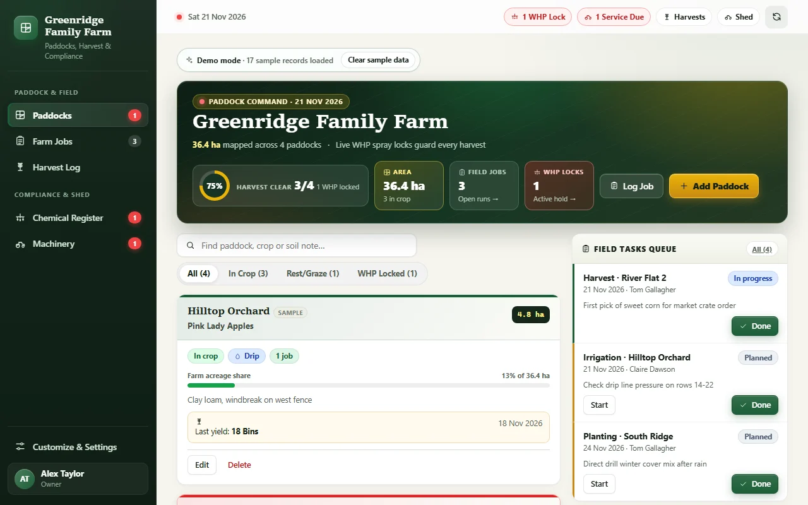 | **AgriLog**<br>`bundles/business/AgriLog/` | Turnkey farm operations tracker: paddocks with live chemical withholding period locks, crop jobs, harvest yield log, chemical register, and machinery maintenance. |
| 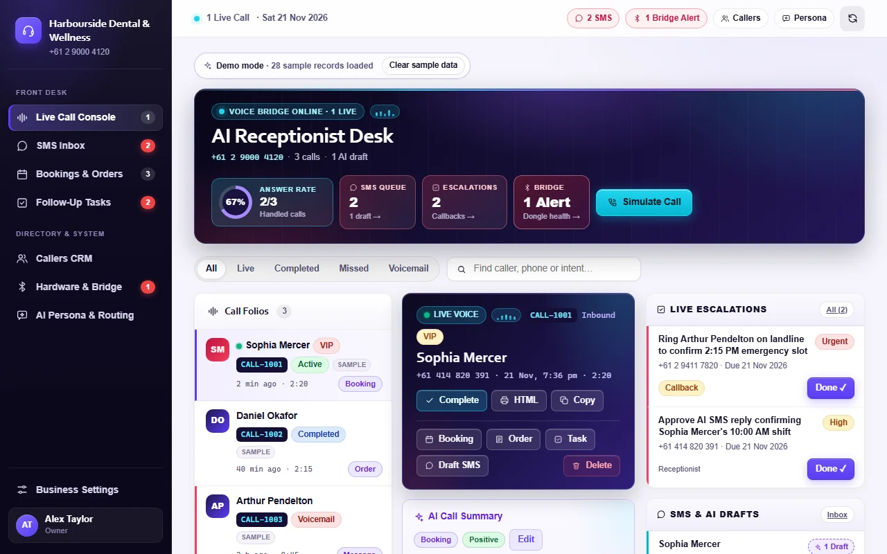 | **Aokie Receptionist**<br>`bundles/business/AokieReceptionist/` | Turnkey AI phone & front-desk console: two-pane live call console with structured Caller/AI transcripts, two-pane SMS inbox with AI draft approval, appointments & orders desk, follow-up tasks queue, callers CRM, Bluetooth dongle hardware events log and AI persona/routing configuration. |
| 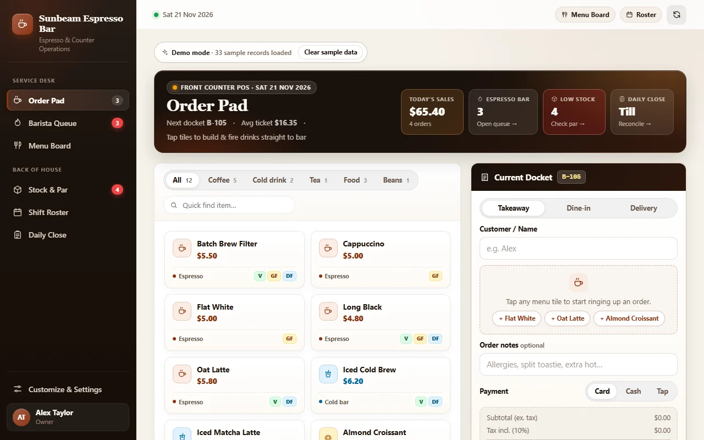 | **BrewDesk**<br>`bundles/business/BrewDesk/` | Turnkey cafe and barista operations desk: live order pad, espresso ticket queue, menu board, beans and milk par stock, shift roster and daily closeout. |
| 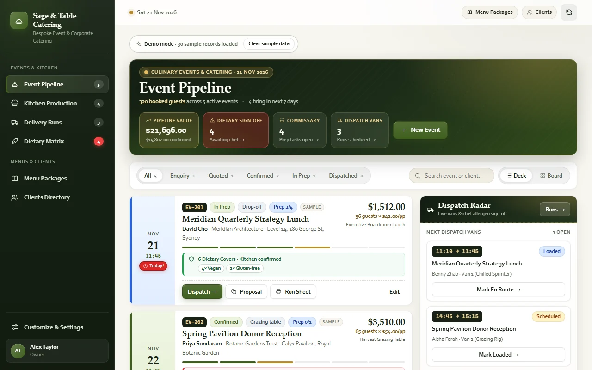 | **CaterCraft**<br>`bundles/business/CaterCraft/` | Turnkey catering & event orders hub: visual event pipeline with automatic per-head quote calculation and HTML run-sheets, multi-station kitchen production board, delivery dispatch runs, dietary requirements matrix with kitchen sign-off, menu packages and client directory. |
| 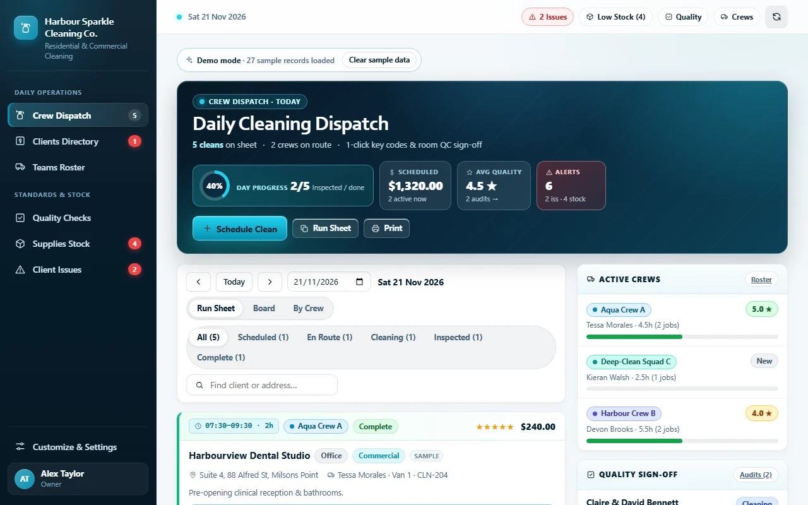 | **CleanShift**<br>`bundles/business/CleanShift/` | Turnkey cleaning business scheduler: crew dispatch board, client access instructions, teams roster, quality checklists & star ratings, supply par stock, and client issues desk. |
| 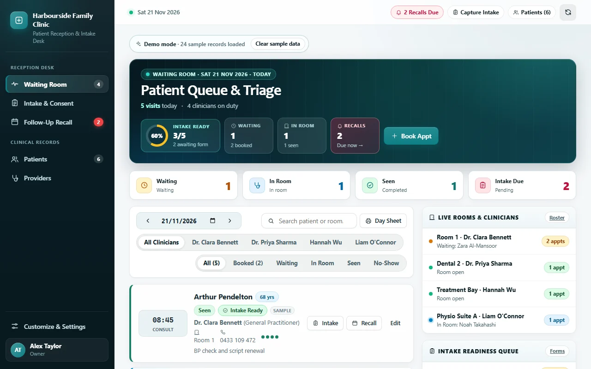 | **Clinic Front Desk**<br>`bundles/business/ClinicFrontDesk/` | Turnkey clinic reception and patient flow desk: live waiting room queue, patient directory and dossiers, digital intake and consent forms, clinician roster, and follow-up recall queue. |
| 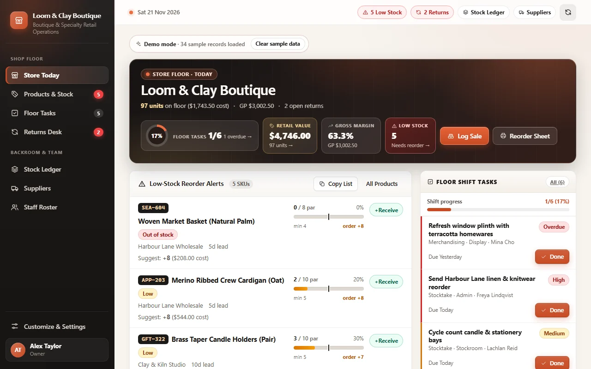 | **CounterFlow**<br>`bundles/business/CounterFlow/` | Turnkey retail store operations hub around the till: product catalogue with live margins and quick stock adjustments, audited stock ledger, floor tasks, suppliers, staff roster, and customer returns desk. |
| 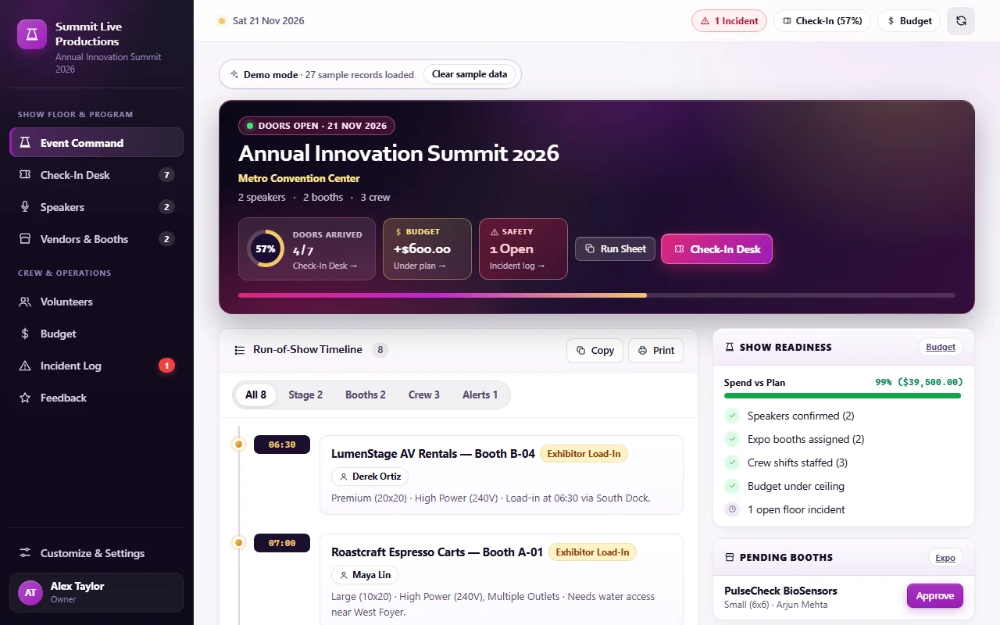 | **Event Hub**<br>`bundles/business/EventHub/` | Turnkey event operations command center with 1-tap attendee check-in desk, dietary & accessibility alerts, speaker program, vendor booths, volunteer roster, live budget variance, incident log, and post-event feedback. |
| 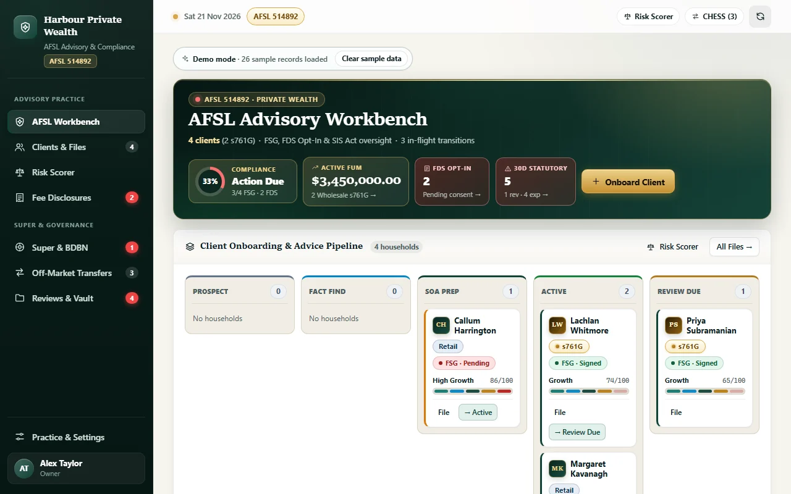 | **Finance OS (AU)**<br>`bundles/business/FinanceOSAU/` | Turnkey Australian AFSL advisory & compliance workbench: client onboarding, Best Interest Duty risk profile scorer, Fee Disclosure Statements (FDS), superannuation rollovers, 100%-validated BDBNs, off-market transfers, annual reviews and document vault. |
| 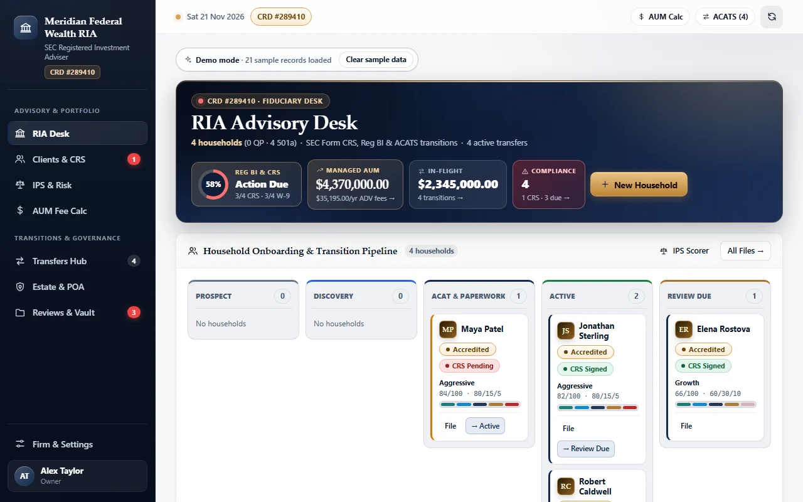 | **Finance OS (US)**<br>`bundles/business/FinanceOSUS/` | Turnkey US RIA & wealth compliance workbench: client onboarding, SEC Form CRS & W-9 tracking, Reg BI risk tolerance scorer, tiered AUM fee agreement calculator, ACAT/Rollover/1035 transfers hub, 100%-validated beneficiary designations, POA, annual reviews and document vault. |
| 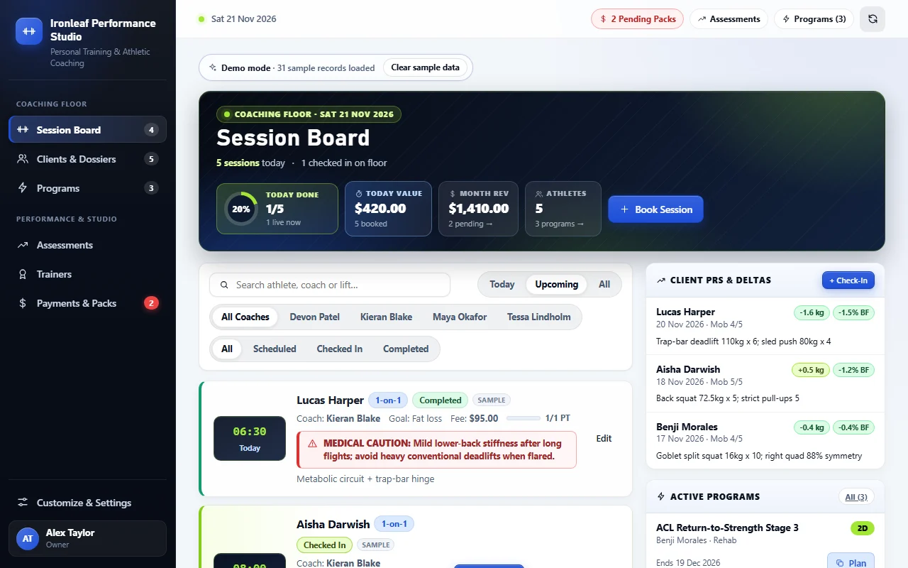 | **FitStudio**<br>`bundles/business/FitStudio/` | Turnkey personal training and gym coaching operations desk: live coach session board, client progress dossiers with automatic body-composition deltas, assessments log, workout program builder, trainer roster, and payments ledger. |
| 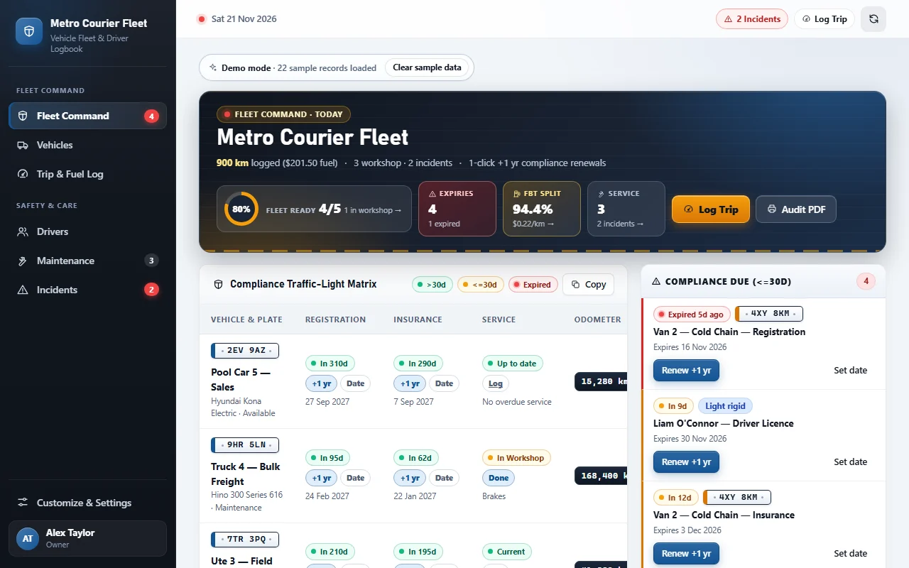 | **FleetFlow**<br>`bundles/business/FleetFlow/` | Turnkey vehicle fleet and driver logbook: live rego, insurance and licence expiry countdown alerts, vehicle register with automatic odometer syncing from trips, FBT business/personal trip and fuel logbook, workshop maintenance pipeline, and incident register. |
| 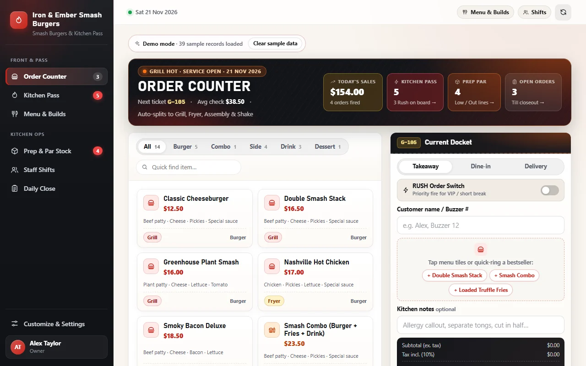 | **GrillStack**<br>`bundles/business/GrillStack/` | Turnkey burger shop command center: live order counter with Rush toggle, multi-station kitchen pass KDS (Grill, Fryer, Assembly, Drinks), menu & ingredient builds, prep & par stock, crew shifts with break tracking, and nightly till reconciliation. |
| 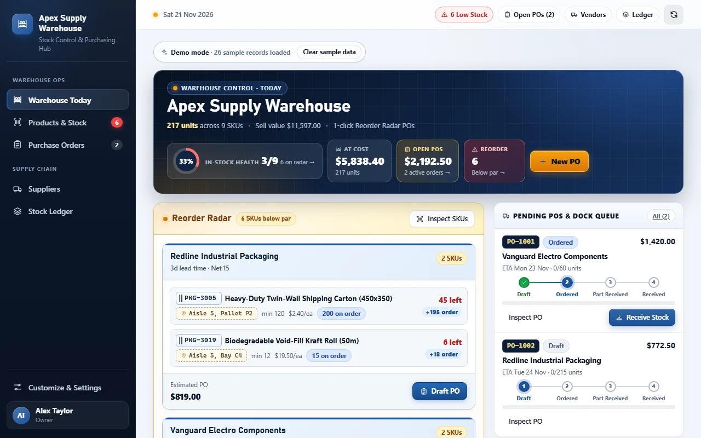 | **Inventory & POs**<br>`bundles/business/InventoryPOs/` | Turnkey warehouse stock control and purchasing hub: SKU bin locations, low-stock reorder alerts with 1-click Draft PO, multi-line purchase order builder, atomic goods receiving, printable POs, suppliers, and stock audit ledger. |
| 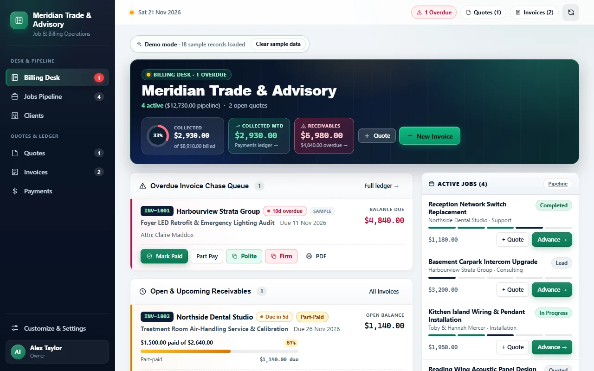 | **Job & Invoice Desk**<br>`bundles/business/JobInvoiceDesk/` | Turnkey job-to-quote-to-invoice-to-payment billing pipeline with client ledger, auto-numbered quotes & tax invoices, partial payment reconciliation, and overdue chase queue. |
| 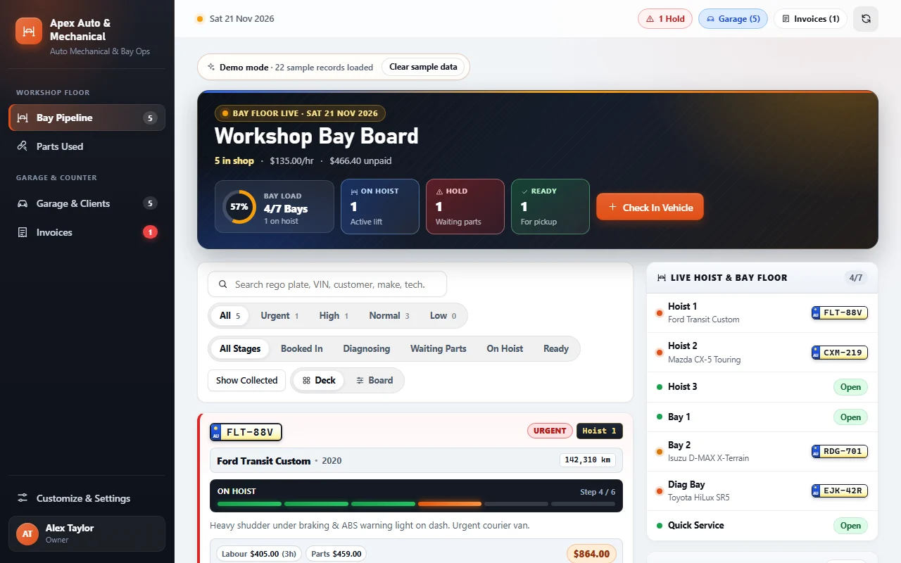 | **Mechanic Workshop**<br>`bundles/business/MechanicWorkshop/` | Turnkey automotive workshop and bay manager: live bay pipeline board, job card workbench with inline parts used, vehicle garage with rego/VIN & odometer auto-update, and 1-click workshop invoicing. |
| 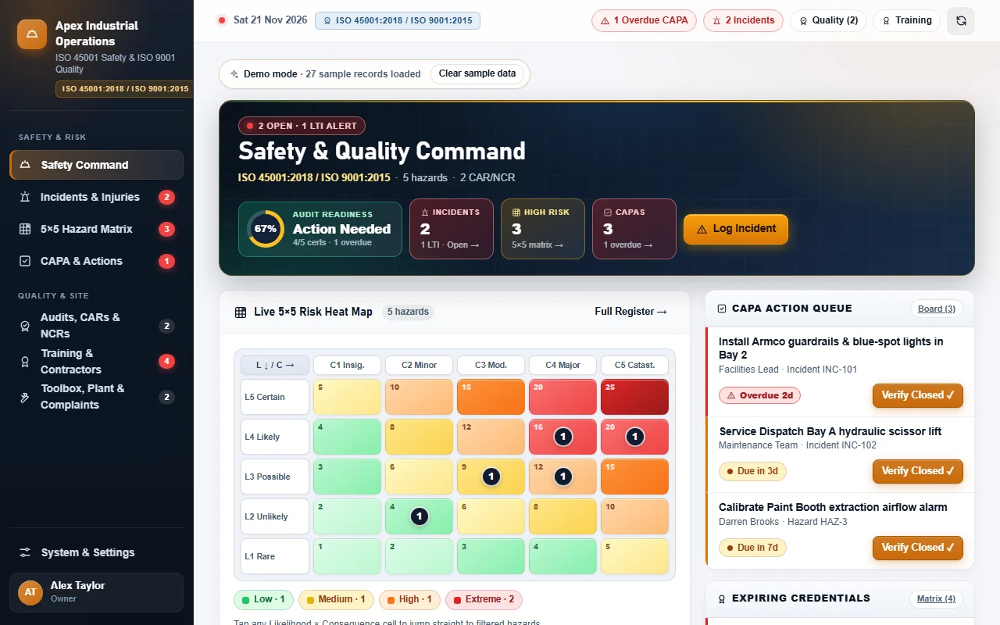 | **OHS & QMS**<br>`bundles/business/OHSQMS/` | Turnkey ISO 45001 safety and ISO 9001 quality management system: incident & injury register, interactive 5x5 risk matrix hazard register, CAPA tracker, audits/CARs/NCRs with printable reports, mandatory training matrix, contractor approvals, toolbox talks, complaints and plant register. |
| 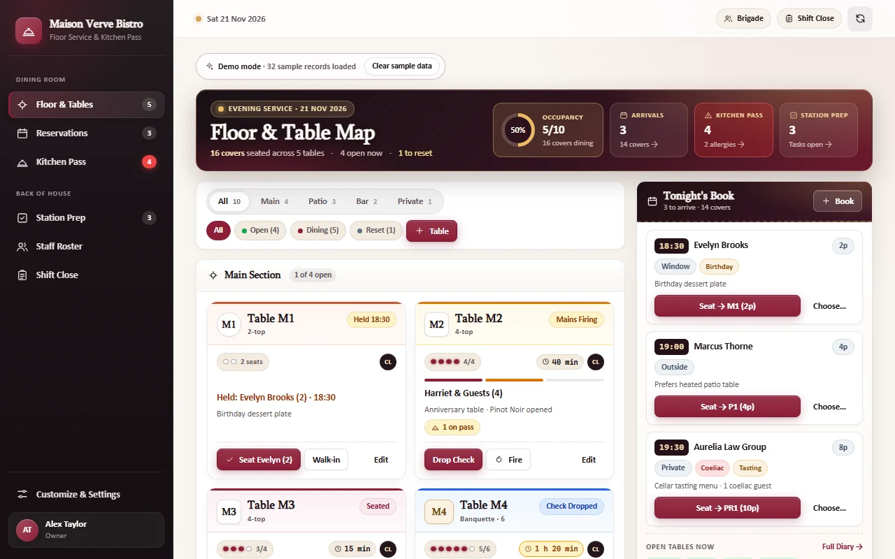 | **PassMaster**<br>`bundles/business/PassMaster/` | Turnkey restaurant front-of-house & kitchen pass: interactive section floor map, reservations book with 1-click table seating, course kitchen pass with red allergy alerts, station prep checklist, brigade roster and nightly shift close. |
| 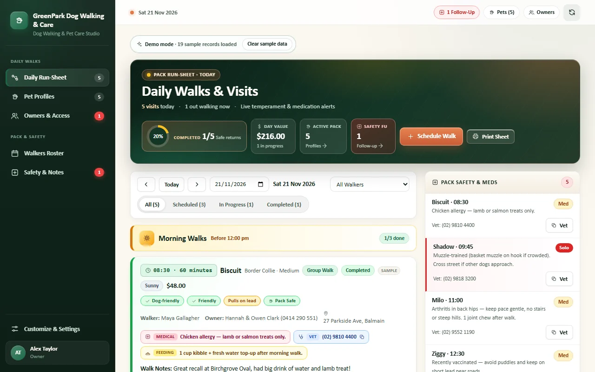 | **PawRoute**<br>`bundles/business/PawRoute/` | Turnkey dog walking & pet care operations hub: daily walk run-sheet with 1-click owner updates, temperament & medical pet profiles, home access client cards, walkers roster, and incidents log. |
| 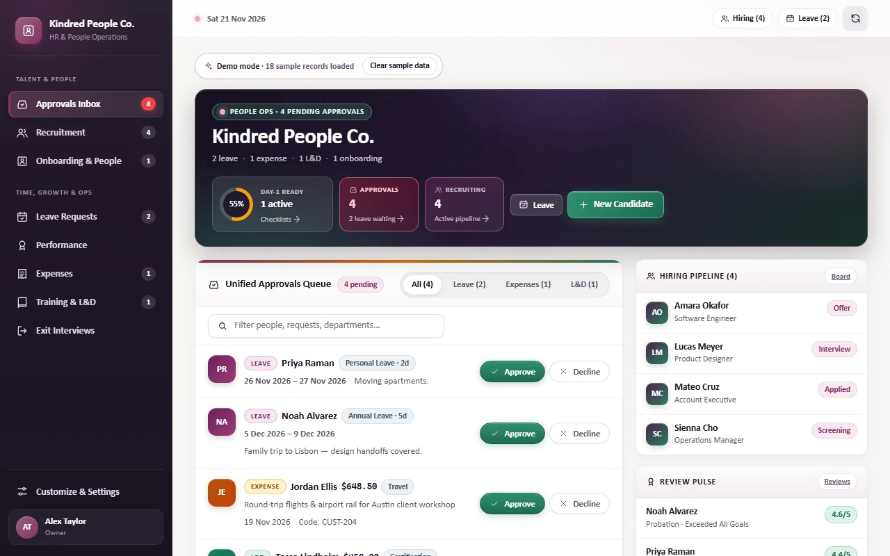 | **People Hub**<br>`bundles/business/PeopleHub/` | Turnkey HR & people operations desk with actionable approvals inbox, recruitment pipeline & interview scorecards, interactive onboarding checklists, leave, performance reviews, expenses, training, and exit interviews. |
| 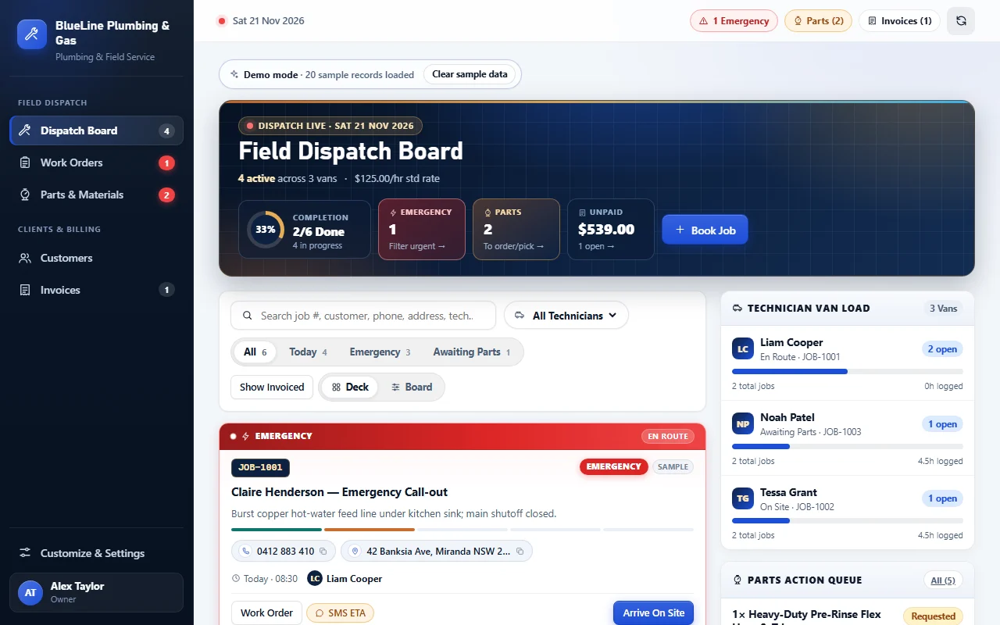 | **Plumbing & Trades**<br>`bundles/business/PlumbingTrades/` | Turnkey field service operations for plumbing and trades businesses: priority dispatch board, on-site work orders, parts & materials tracking, customer directory, and 1-click job invoicing. |
| 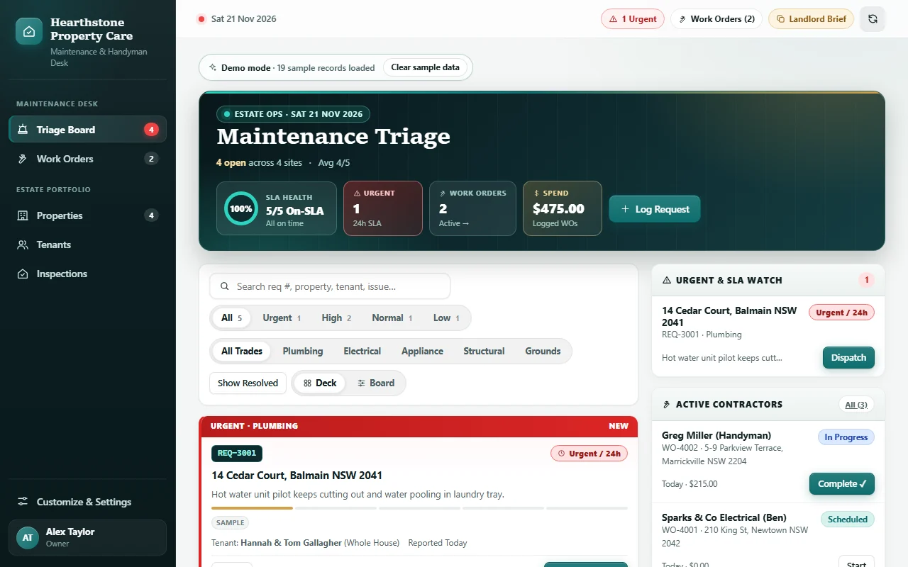 | **Property Maintenance**<br>`bundles/business/PropertyMaintenance/` | Turnkey property maintenance and handyman operations desk: tenant request triage board, 1-click work order dispatch, properties register with access notes, tenants directory, and rated property inspections. |
| 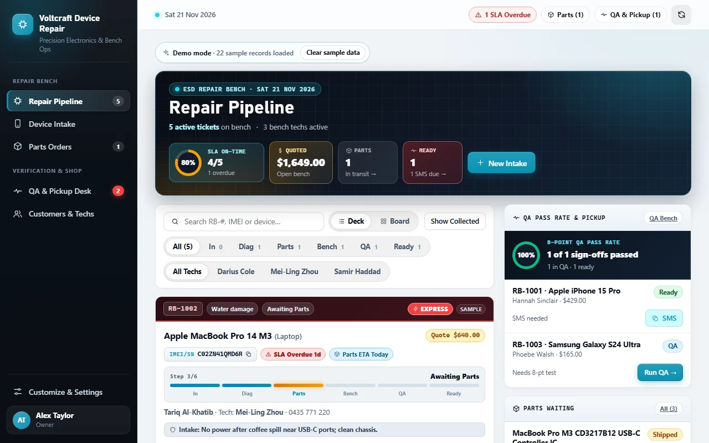 | **RepairBench**<br>`bundles/business/RepairBench/` | Turnkey electronics and device repair workshop desk: 7-stage repair pipeline board with printable claim tickets, device IMEI/serial intake registry, parts order tracker, interactive QA test checklist and pickup SMS desk, plus customers and bench technicians. |
| 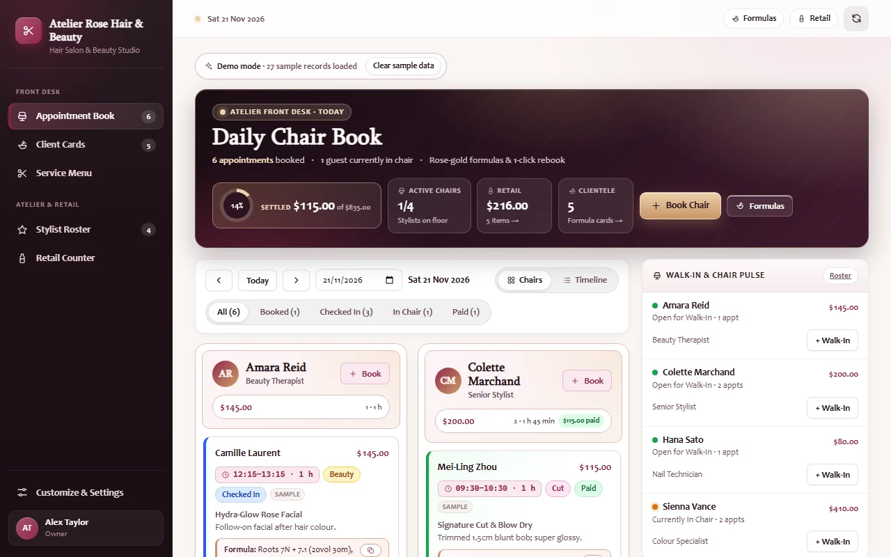 | **Salon Studio**<br>`bundles/business/SalonStudio/` | Turnkey hair salon & beauty studio manager: daily appointment book by stylist with auto-filled service pricing & conflict checks, client colour formula cards, service menu, stylist roster, and retail sales with printable receipts. |
| 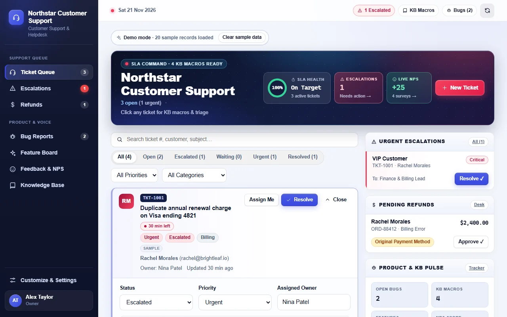 | **Service Desk**<br>`bundles/business/ServiceDesk/` | Turnkey customer support helpdesk with ticket triage queue, 1-click escalations, bug tracker, upvotable feature board, refunds desk, live NPS calculator, and searchable knowledge base. |
| 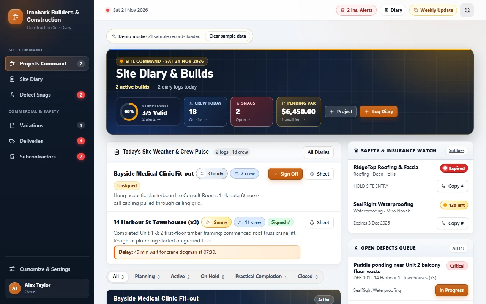 | **SitePulse**<br>`bundles/business/SitePulse/` | Turnkey construction site diary and builder command hub: active projects overview, daily site diaries with weather & sign-off, defect snag list, client-approved variations, deliveries log, and subcontractor insurance expiry tracking. |
| 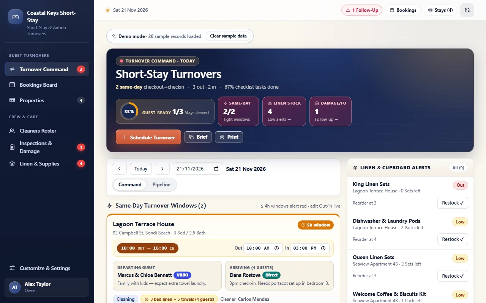 | **StayReady**<br>`bundles/business/StayReady/` | Turnkey short-stay & Airbnb turnover manager: same-day checkout/check-in command board, bookings board, cleaner turnover pipeline, lockbox access directory, inspections & damage log, and per-property supply stock. |
| 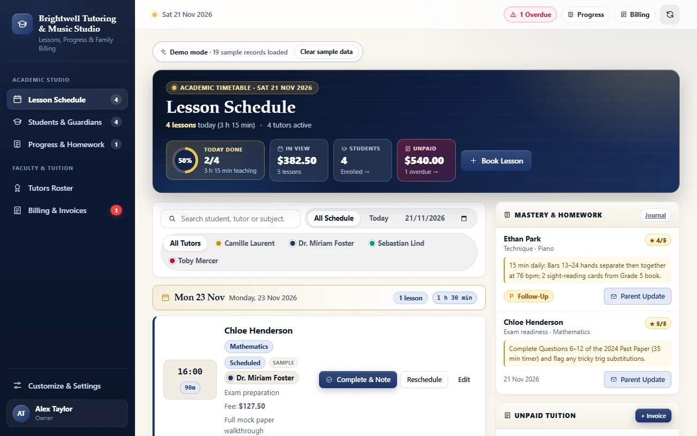 | **TutorTrack**<br>`bundles/business/TutorTrack/` | Turnkey tutoring studio and music lessons desk: filterable lesson schedule with one-click progress note logging, student and guardian dossiers, homework and copyable parent updates, tutor roster, and printable HTML tuition invoices. |
| 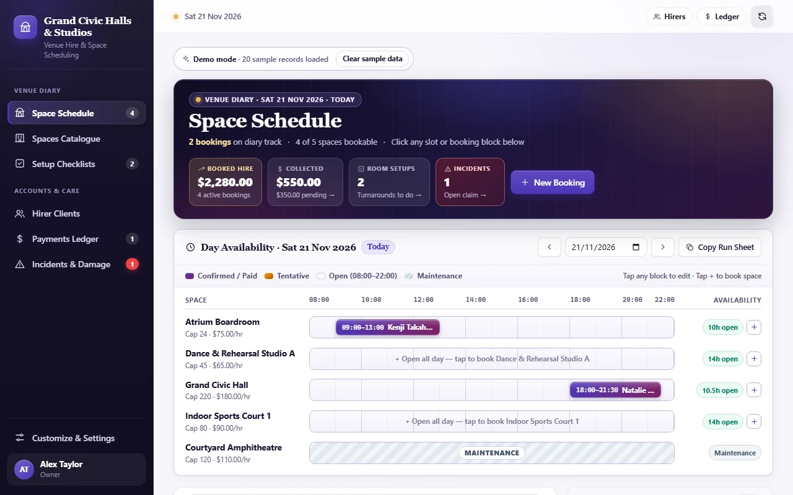 | **VenueOps**<br>`bundles/business/VenueOps/` | Turnkey venue hire & booking manager: space schedule with automatic time-overlap conflict detection and hourly fee calculation, spaces catalogue, setup & facilities checklists, hirer clients directory, payments & deposits ledger with HTML booking confirmations, and incidents/damage log. |

### Flagship games

| | Example | What it shows |
|---|---|---|
| 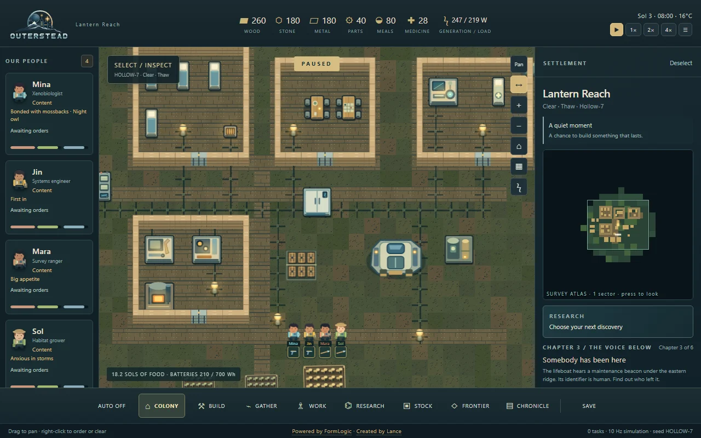 | **Outerstead**<br>`bundles/games/Outerstead/` | First Light: a people-first frontier colony survival game on Hollow-7. Four survivors, a growing settlement, and an older world that still listens. |
| 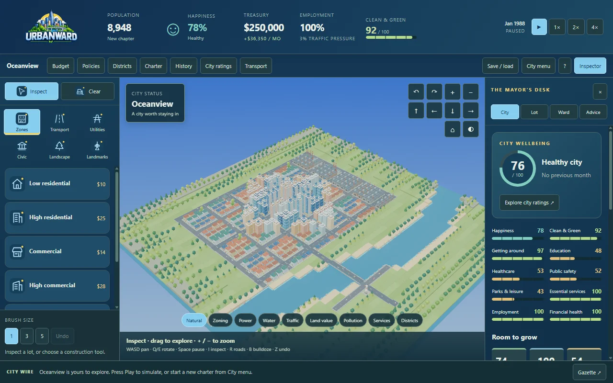 | **Urbanward**<br>`bundles/games/Urbanward/` | An original, modular city simulation: build connected neighbourhoods, balance the books and watch a city find its identity. |
|  | **Outermate**<br>`bundles/games/Outermate/` | First Count: a living prison-escape strategy game on Hollow-7. Learn routines, trade favours, prepare a route and get beyond Greywall. |
| 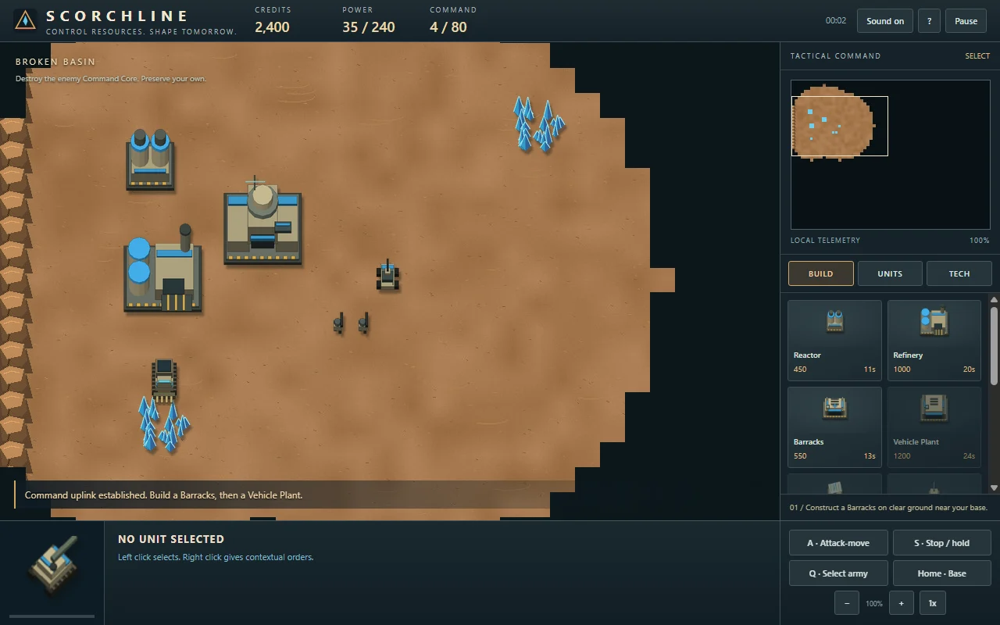 | **Scorchline**<br>`bundles/games/Scorchline/` | An original top-down resource-warfare RTS. Two factions, three maps and offline AI skirmishes. |
|  | **Potato Peeler**<br>`bundles/games/PotatoPeeler/` | Mobile-ready Soviet 3D commissary potato-peeling game with 17 Blender PBR kitchen models, tactile touch & mouse 16-patch 3D potato shaving, Canteen Borscht & Banquet dish orders, Podstakannik Tea Overdrive, Colorado Saboteur Beetles, Boss Tsar-Kartoshka events, 6 upgradable peelers up to the Kosmos-9 ruby laser-lathe, Radio Mayak polka, and a Hall of Labour leaderboard. |

### Runtime showcase

| | Example | What it shows |
|---|---|---|
|  | **Component Showcase**<br>`bundles/samples/Showcase/` | Interactive UI controls, charts, spring animations, drag-and-drop widgets, and an articulated PBR Chrono Orrery 3D studio scene with HDR IBL, GTAO, Bloom, and SceneAnchor |

## Play them

- On [softn.com](https://softn.com): every listed example is in the directory and opens in the web runtime.
- From a release: download the `.softn` file from the latest [release](../../releases) and open it in the SoftN web runtime with its file picker, or serve the file and open the runtime with `?open=<url of the bundle>`.
- From a softn.com checkout: `npm run fetch:demos` there downloads the pinned release into `apps/softn-web/public/demos/`, and `npm run dev:web` serves them at `http://localhost:1420/?open=/demos/<Name>.softn`.

## Build

```sh
npm ci
npm test                                                                                    # PotatoPeeler tests, validator tests, then every bundle packed and validated
npm run build                                                                               # dist/<Name>.softn for every bundle, plus SHA256SUMS.txt, catalogue.json and RELEASE_NOTES.md
npm run bundle -- BrewDesk                                                                  # one bundle by name, into dist/
node scripts/test/test-bundle.cjs dist/BrewDesk.softn --source bundles/business/BrewDesk    # the check the SoftN loaders apply, against the sources
```

Node 20.19 or newer. A build is deterministic from the sources: files are enumerated in sorted order and compressed deterministically, so the same source tree always packs to the same archive and digest.

## Release

1. Bump `version` in `package.json` and commit.
2. Either tag and push (`git tag v1.1.0 && git push origin v1.1.0`), publish a GitHub Release for that tag in the GitHub UI, or run the `Release` workflow manually (`workflow_dispatch`).

softn.com then pins the new release from its own checkout:

```sh
node scripts/demos/fetch-demos.mjs --pin v1.1.0
```

## Layout

| Path | What it is |
| --- | --- |
| `bundles/business/<Name>/` | Full-stack Engine 2 Web Container business apps: `manifest.json`, `index.html`, `css/`, `js/`, `kit/`, `server/public/index.php`, `server/migrations/schema.sql`, and `server/vendor/`. |
| `bundles/games/<Name>/` | Flagship games: `Outerstead`, `Urbanward`, `Outermate`, `Scorchline`, and `PotatoPeeler`. |
| `bundles/samples/Showcase/` | SoftN UI component, chart, animation, and 3D PBR runtime showcase. |
| `catalogue.json` | The directory's entries: `id`, `file`, `name`, `description`, `category`, optional `subcategory`/`tags`, and `primary` colour. |
| `scripts/build/build-bundle.cjs` | Packs one or all discovered Engine 1 & Engine 2 bundles into `dist/<Name>.softn`. |
| `scripts/build/build-release.cjs` | Packs every bundle into `dist/` and writes `SHA256SUMS.txt`, `catalogue.json` and `RELEASE_NOTES.md`. |
| `scripts/test/test-bundle.cjs` | Structural, composition and source-parity validator for both Engine 1 and Engine 2 `.softn` bundles. |
| `screenshots/` | 1280×800 WebP thumbnails (`<Name>.webp`), one per catalogued example. |

## Licence

Apache License 2.0; see `LICENSE` and `NOTICE.md`.
